<!-- pattern: b01 title_page -->
<!-- source: https://github.com/carnot-tech/jinba-consulting-pptx-skill@e5f35e57e14d3998249a559c620a9286c95b4595 templates/freeform_parts_16x9.html part=01 -->

<!-- _class: title -->

# 表紙

## 学際研究支援計画

### 構想から運用へ

架空の共同実験支援室 
研究計画検討会・説明用サンプル

::: cite
b01 / title_page — 題名・発表者・場を置く（架空例）
:::

---

<!-- pattern: b02 overview_map -->
<!-- source: https://github.com/carnot-tech/jinba-consulting-pptx-skill@e5f35e57e14d3998249a559c620a9286c95b4595 templates/freeform_parts_16x9.html part=02 -->

# 全体マップ

::: band
目的：研究データを次の実験につなぐ
:::

:::: grid-3
::: card
### 計画する
問い・評価指標を定義
:::
::: card
### 記録する
試料・条件を対応付け
:::
::: card
### 共有する
権限・公開範囲を確認
:::
::::

::: foundation
共通基盤：識別子 ／ 記録様式 ／ 相談窓口
:::

::: cite
b02 / overview_map — 目的・領域・共通基盤の関係（架空例）
:::

---

<!-- pattern: b03 table_of_contents -->
<!-- source: https://github.com/carnot-tech/jinba-consulting-pptx-skill@e5f35e57e14d3998249a559c620a9286c95b4595 templates/freeform_parts_16x9.html part=03 -->

# 目次

## 研究支援計画を四つの問いで考える

1. なぜ今、記録を見直すのか
2. どの実験から試行するのか
3. 誰が運用を担うのか
4. 何をもって継続を判断するのか

::: cite
b03 / table_of_contents — 議論の順序を予告する（架空例）
:::

---

<!-- pattern: b04 section_divider -->
<!-- source: https://github.com/carnot-tech/jinba-consulting-pptx-skill@e5f35e57e14d3998249a559c620a9286c95b4595 templates/freeform_parts_16x9.html part=04 -->

<!-- _class: section -->

# 章扉

## 02　試行の設計

小さく試し、評価条件をそろえる

::: cite
b04 / section_divider — 次の章へ視点を切り替える（架空例）
:::

---

<!-- pattern: b05 chevron_steps -->
<!-- source: https://github.com/carnot-tech/jinba-consulting-pptx-skill@e5f35e57e14d3998249a559c620a9286c95b4595 templates/freeform_parts_16x9.html part=05 -->

# 矢羽（プロセス・変遷）

## 問いから検証までの順序をそろえる

<h3>01 問いを置く</h3>
再利用を妨げる条件

<h3>02 試行する</h3>
記録様式を統一

<h3>03 評価する</h3>
探索時間を比較

::: cite
b05 / chevron_steps — 工程の進行を矢羽で示す（架空例）
:::

---

<!-- pattern: b06 premise_conclusion -->
<!-- source: https://github.com/carnot-tech/jinba-consulting-pptx-skill@e5f35e57e14d3998249a559c620a9286c95b4595 templates/freeform_parts_16x9.html part=06 -->

# 前提→帰結の2カラム

:::: cols
### 前提：記録が分散している

- 条件表は担当者ごとに保管
- 試料番号の付け方が異なる
- 引き継ぎに口頭説明が必要

|||

::: band
### 帰結：対応関係から整える
試料・条件・結果を 
共通の識別子で結ぶ
:::
::::

::: cite
b06 / premise_conclusion — 前提から帰結を導く（架空例）
:::

---

<!-- pattern: b07 stat_table_readout -->
<!-- source: https://github.com/carnot-tech/jinba-consulting-pptx-skill@e5f35e57e14d3998249a559c620a9286c95b4595 templates/freeform_parts_16x9.html part=07 -->

# 大型数値の表＋読み取り

:::: cols
<table>
<thead><tr><th>試行の規模</th><th>架空の設定値</th></tr></thead>
<tbody>
<tr><td>対象の実験記録</td><td><h2>24 件</h2></td></tr>
<tr><td>協力する研究班</td><td><h2>3 班</h2></td></tr>
</tbody>
</table>

|||

### 読み取り

::: callout
全体展開の前に、 
班をまたぐ検索の流れを 
小規模で確かめる。
:::
::::

::: cite
b07 / stat_table_readout — 数値の表から意味を読み取る（架空例）
:::

---

<!-- pattern: b08 card_grid_2x2 -->
<!-- source: https://github.com/carnot-tech/jinba-consulting-pptx-skill@e5f35e57e14d3998249a559c620a9286c95b4595 templates/freeform_parts_16x9.html part=08 -->

# 並列カード 2×2

:::: grid-2
::: card
### 試料
由来と識別子を残す
:::
::: card
### 条件
装置と設定を残す
:::
::: card
### 結果
元データと図を結ぶ
:::
::: card
### 判断
採否と理由を残す
:::
::::

::: cite
b08 / card_grid_2x2 — 同格の四要素を並べる（架空例）
:::

---

<!-- pattern: b09 axis_table -->
<!-- source: https://github.com/carnot-tech/jinba-consulting-pptx-skill@e5f35e57e14d3998249a559c620a9286c95b4595 templates/freeform_parts_16x9.html part=09 -->

# 軸のある表

## 記録の単位 × 利用する場面

| 記録の単位 ↓ ／ 場面 → | 実験の再現 | 班内の引き継ぎ | 班をまたぐ再利用 |
|:--|:--|:--|:--|
| 試料 | ロット・保管条件 | 残量・所在 | 利用条件 |
| 操作 | 手順・設定値 | 注意点 | 装置の互換性 |
| 結果 | 元データ | 採否の理由 | 解析条件 |

::: cite
b09 / axis_table — 縦軸と横軸の交点を読む（架空例）
:::

---

<!-- pattern: b10 back_cover -->
<!-- source: https://github.com/carnot-tech/jinba-consulting-pptx-skill@e5f35e57e14d3998249a559c620a9286c95b4595 templates/freeform_parts_16x9.html part=10 -->

# 裏表紙

::: center
## ご議論ありがとうございました

次回は、試行の評価設計を持ち寄ります。

研究計画検討会 
架空の共同実験支援室
:::

::: foundation
連絡方法：資料の作成担当者へ（説明用の架空例）
:::

::: cite
b10 / back_cover — 議論を閉じ、次の接点を残す（架空例）
:::

---

<!-- pattern: b11 claim_panel_figure -->
<!-- source: https://github.com/carnot-tech/jinba-consulting-pptx-skill@e5f35e57e14d3998249a559c620a9286c95b4595 templates/freeform_parts_16x9.html part=11 -->

# 主張パネル＋図

:::: cols
::: band
### 記録の入口をそろえる
相談先を一つにし、 
担当の振り分けは 
支援室が引き受ける。
:::

|||

### 集約の模式図

材料班

計測班

解析班

↓　　　 ↓　　　 ↓

共同窓口 → 担当者へ振り分け

::::

::: cite
b11 / claim_panel_figure — 主張を関係図で補う（架空例）
:::

---

<!-- pattern: b12 lever_effect_table -->
<!-- source: https://github.com/carnot-tech/jinba-consulting-pptx-skill@e5f35e57e14d3998249a559c620a9286c95b4595 templates/freeform_parts_16x9.html part=12 -->

# 打ち手の効果表

| 打ち手 | 変える対象 | 期待する効果 | 確認する指標 |
|:--|:--|:--|:--|
| 共通の識別子 | 対応付け | 探し直しを減らす | 検索の所要時間 |
| 入力項目の必須化 | 記録の抜け | 再確認を減らす | 未記入の件数 |
| 相談窓口の集約 | 問い合わせ | 取り次ぎを減らす | 初回回答までの日数 |

::: callout
効果は仮説として置き、試行の前後で確かめる。
:::

::: cite
b12 / lever_effect_table — 打ち手と想定効果を結ぶ（架空例）
:::

---

<!-- pattern: b13 status_heatmap_comment -->
<!-- source: https://github.com/carnot-tech/jinba-consulting-pptx-skill@e5f35e57e14d3998249a559c620a9286c95b4595 templates/freeform_parts_16x9.html part=13 -->

# 状態ヒートマップ＋右コメント

:::: cols
| 担当 | 試料 | 条件 | 結果 |
|:--|:--:|:--:|:--:|
| 材料班 | **済**{.status-high} | **中**{.status-mid} | **未**{.status-low} |
| 計測班 | **済**{.status-high} | **済**{.status-high} | **中**{.status-mid} |
| 解析班 | **中**{.status-mid} | **未**{.status-low} | **未**{.status-low} |

|||

### 次に確認すること

::: callout
解析班の「条件」を先に整え、 
結果との対応付けを進める。
:::

済：完了 ／ 中：作業中 ／ 未：未着手
::::

::: cite
b13 / status_heatmap_comment — 状態の分布から次の対応を示す（架空例）
:::

---

<!-- pattern: b14 harvey_ball_table -->
<!-- source: https://github.com/carnot-tech/jinba-consulting-pptx-skill@e5f35e57e14d3998249a559c620a9286c95b4595 templates/freeform_parts_16x9.html part=14 -->

# 充足度評価表（ハーベイボール）

| 記録方式 | 再現に必要な情報 | 引き継ぎのしやすさ | 権限の管理 |
|:--|:--:|:--:|:--:|
| 個人ノート | ◐ | ◔ | ○ |
| 共通シート | ● | ◐ | ◐ |
| 管理台帳 | ◐ | ● | ● |

○ 未充足　◔ 一部　◐ 半分程度　● 充足

評価は架空の検討例。方式全体の優劣ではなく、要件の充足度を比べる。

::: cite
b14 / harvey_ball_table — 要件の充足度を円で比較する（架空例）
:::

---

<!-- pattern: b15 dot_matrix_share -->
<!-- source: https://github.com/carnot-tech/jinba-consulting-pptx-skill@e5f35e57e14d3998249a559c620a9286c95b4595 templates/freeform_parts_16x9.html part=15 -->

# 割合のドットマトリクス

::: figure
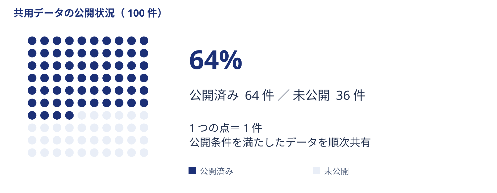
:::

::: cite
b15 / dot_matrix_share — 全体に占める割合を点で数える（架空例）
:::

---

<!-- pattern: b16 progress_bubble_matrix -->
<!-- source: https://github.com/carnot-tech/jinba-consulting-pptx-skill@e5f35e57e14d3998249a559c620a9286c95b4595 templates/freeform_parts_16x9.html part=16 -->

# 進捗バブル行列

::: figure
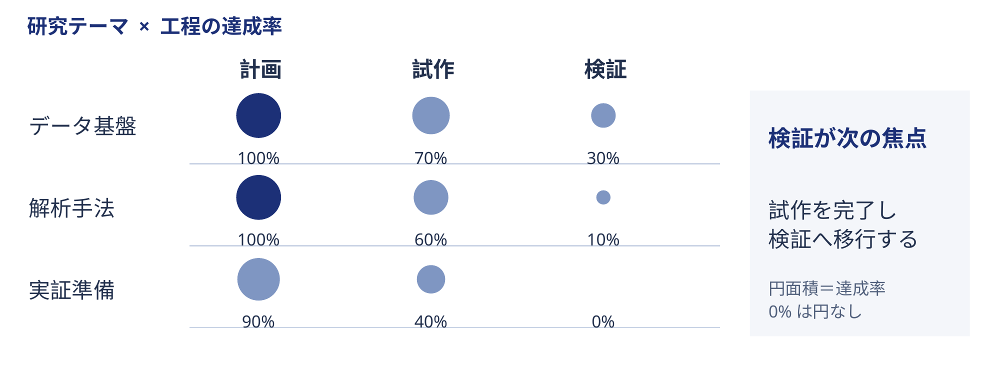
:::

::: cite
b16 / progress_bubble_matrix — 工程と担当の進捗・規模を見る（架空例）
:::

---

<!-- pattern: b17 ranked_bar_annotated -->
<!-- source: https://github.com/carnot-tech/jinba-consulting-pptx-skill@e5f35e57e14d3998249a559c620a9286c95b4595 templates/freeform_parts_16x9.html part=17 -->

# 分布の順位棒＋注記

::: figure
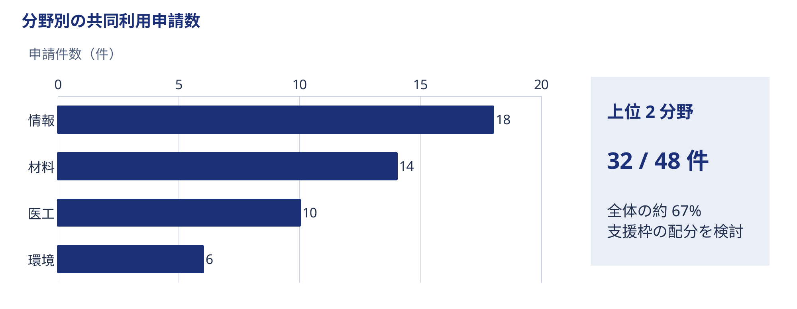
:::

::: cite
b17 / ranked_bar_annotated — 順位分布の注目点を示す（架空例）
:::

---

<!-- pattern: b18 scatter_annotated -->
<!-- source: https://github.com/carnot-tech/jinba-consulting-pptx-skill@e5f35e57e14d3998249a559c620a9286c95b4595 templates/freeform_parts_16x9.html part=18 -->

# 注記つき散布図

::: figure
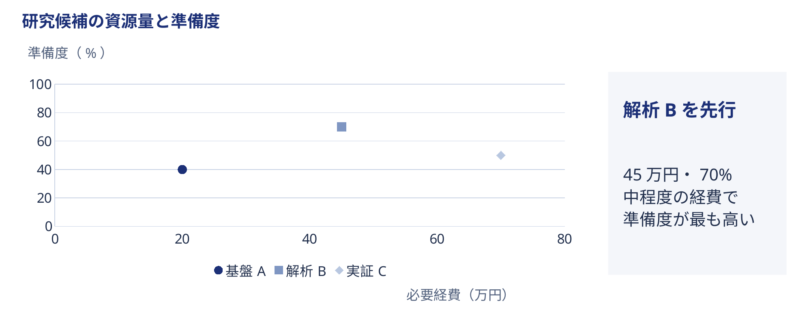
:::

::: cite
b18 / scatter_annotated — 二変数の関係と例外を読む（架空例）
:::

---

<!-- pattern: b19 pillars_foundation -->
<!-- source: https://github.com/carnot-tech/jinba-consulting-pptx-skill@e5f35e57e14d3998249a559c620a9286c95b4595 templates/freeform_parts_16x9.html part=19 -->

# 柱＋土台

:::: grid-3
::: navy-card
### 記録の標準化
必須項目をそろえる
:::
::: navy-card
### 支援の分担
相談と実務をつなぐ
:::
::: navy-card
### 再利用の確認
次の実験で試す
:::
::::

::: foundation
共通の土台：識別子・権限・データ管理計画
:::

::: cite
b19 / pillars_foundation — 複数の柱を共通の土台で支える（架空例）
:::

---

<!-- pattern: b20 opposing_chevrons -->
<!-- source: https://github.com/carnot-tech/jinba-consulting-pptx-skill@e5f35e57e14d3998249a559c620a9286c95b4595 templates/freeform_parts_16x9.html part=20 -->

# 対向シェブロン

## 現場の要望と支援条件をすり合わせる

<h3>研究班から →</h3>
入力は最小限にしたい 実験の途中でも相談したい

<h3>← 支援室から</h3>
再現に必要な条件を残したい 公開前に権限を確認したい

::: center
接点：必須項目は少なく、相談の入口は早く
:::

::: cite
b20 / opposing_chevrons — 両側の要請を接点で合わせる（架空例）
:::

---

<!-- pattern: b21 evidence_clip_grid -->
<!-- source: https://github.com/carnot-tech/jinba-consulting-pptx-skill@e5f35e57e14d3998249a559c620a9286c95b4595 templates/freeform_parts_16x9.html part=21 -->

# 外部動向の根拠グリッド

:::: grid-3
::: note
### 募集要項の想定例
> 管理計画を提出する

検討点：記録の責任者
:::
::: note
### 共同利用規程の想定例
> 利用範囲を明示する

検討点：権限の確認
:::
::: note
### 連携先要望の想定例
> 条件表を添付する

検討点：渡す情報の単位
:::
::::

すべて架空の資料断片。実在する制度・機関の引用ではない。

::: cite
b21 / evidence_clip_grid — 資料断片と検討点を対応付ける（架空例）
:::

---

<!-- pattern: b22 proportional_circles -->
<!-- source: https://github.com/carnot-tech/jinba-consulting-pptx-skill@e5f35e57e14d3998249a559c620a9286c95b4595 templates/freeform_parts_16x9.html part=22 -->

# 比例円の対比

::: figure
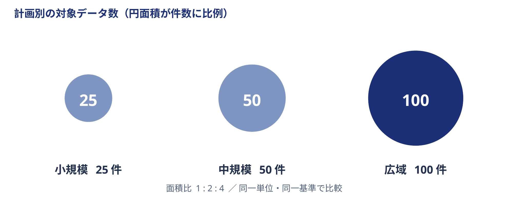
:::

::: cite
b22 / proportional_circles — 面積で規模を比べる（架空例）
:::

---

<!-- pattern: b23 delta_bars_totals -->
<!-- source: https://github.com/carnot-tech/jinba-consulting-pptx-skill@e5f35e57e14d3998249a559c620a9286c95b4595 templates/freeform_parts_16x9.html part=23 -->

# 増減の縦棒＋左右合計

::: figure
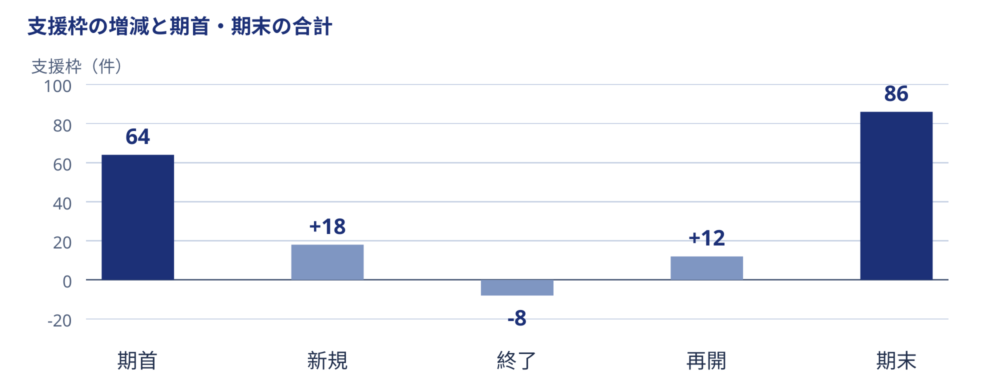
:::

::: cite
b23 / delta_bars_totals — 増減と前後の合計をつなぐ（架空例）
:::

---

<!-- pattern: b24 scenario_lines_cagr -->
<!-- source: https://github.com/carnot-tech/jinba-consulting-pptx-skill@e5f35e57e14d3998249a559c620a9286c95b4595 templates/freeform_parts_16x9.html part=24 -->

# シナリオ線＋成長率チップ

::: figure
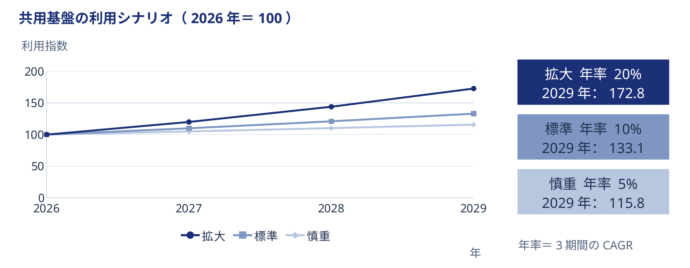
:::

::: cite
b24 / scenario_lines_cagr — 将来の経路と成長率を比較する（架空例）
:::

---

<!-- pattern: b25 research_basis -->
<!-- source: https://github.com/carnot-tech/jinba-consulting-pptx-skill@e5f35e57e14d3998249a559c620a9286c95b4595 templates/freeform_parts_16x9.html part=25 -->

# 調査の土台

## 記録を探す場面を観察する

| 設計項目 | 今回の架空の調査計画 |
|:--|:--|
| 対象 | 3研究班の実験記録担当者 |
| 方法 | 検索課題の観察と短時間の聞き取り |
| 記録すること | 探した場所・止まった理由・確認先 |

::: foundation
境界：研究成果の良否は評価しない。記録をたどる過程に限定する。
:::

::: cite
b25 / research_basis — 調査の対象・方法・境界を決める（架空例）
:::

---

<!-- pattern: b26 issue_action_columns -->
<!-- source: https://github.com/carnot-tech/jinba-consulting-pptx-skill@e5f35e57e14d3998249a559c620a9286c95b4595 templates/freeform_parts_16x9.html part=26 -->

# 課題と打ち手の2カラム

:::: compare
::: card
### 課題：記録を結べない
- 試料名が班ごとに異なる
- 条件表の版が分からない
- 元データの所在が曖昧
:::
::: card
### 打ち手：対応を残す
- 共通の識別子を付ける
- 更新日と版を記す
- 保管先を台帳で結ぶ
:::
::::

::: cite
b26 / issue_action_columns — 課題と打ち手を並べて対応させる（架空例）
:::

---

<!-- pattern: b27 agenda_separator -->
<!-- source: https://github.com/carnot-tech/jinba-consulting-pptx-skill@e5f35e57e14d3998249a559c620a9286c95b4595 templates/freeform_parts_16x9.html part=27 -->

# セパレーター（章扉＝アジェンダ再掲）

:::: cols
::: metric
## 02
試行の設計
:::

|||

01　背景と問い

::: band
**02　試行の設計 ← 現在地**
:::

03　運用と評価

::::

::: cite
b27 / agenda_separator — アジェンダを再掲し現在地を示す（架空例）
:::

---

<!-- pattern: b28 swimlane_numbered_notes -->
<!-- source: https://github.com/carnot-tech/jinba-consulting-pptx-skill@e5f35e57e14d3998249a559c620a9286c95b4595 templates/freeform_parts_16x9.html part=28 -->

# スイムレーン＋番号の付箋

::: figure
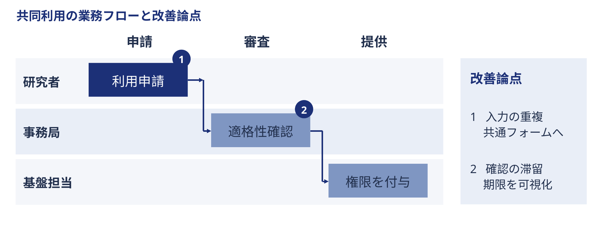
:::

::: cite
b28 / swimlane_numbered_notes — 担当と工程に課題番号を重ねる（架空例）
:::

---

<!-- pattern: b29 front_back_two_tier -->
<!-- source: https://github.com/carnot-tech/jinba-consulting-pptx-skill@e5f35e57e14d3998249a559c620a9286c95b4595 templates/freeform_parts_16x9.html part=29 -->

# 表と裏の2段

::: figure
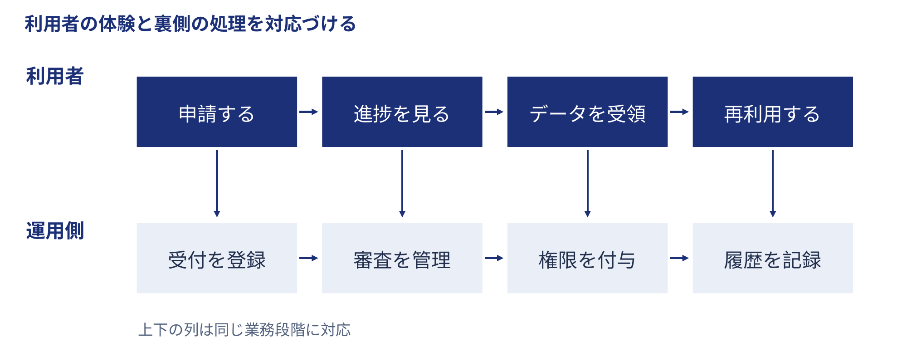
:::

::: cite
b29 / front_back_two_tier — 利用者の流れと裏側の処理を対応させる（架空例）
:::

---

<!-- pattern: b30 qa_list -->
<!-- source: https://github.com/carnot-tech/jinba-consulting-pptx-skill@e5f35e57e14d3998249a559c620a9286c95b4595 templates/freeform_parts_16x9.html part=30 -->

# 一問一答

<table>
<tbody>
<tr><th scope="row">Q. 入力の負担は増えますか？</th><td><strong>A.</strong> まず必須3項目で試します。</td></tr>
<tr><th scope="row">Q. 途中のデータも共有しますか？</th><td><strong>A.</strong> 公開範囲は班ごとに確認します。</td></tr>
<tr><th scope="row">Q. 困ったときは誰に相談しますか？</th><td><strong>A.</strong> 支援室が窓口を引き受けます。</td></tr>
</tbody>
</table>

::: cite
b30 / qa_list — 相手の質問に一つずつ答える（架空例）
:::

---

<!-- pattern: m01 executive_summary -->
<!-- source: https://github.com/carnot-tech/jinba-consulting-pptx-skill@e5f35e57e14d3998249a559c620a9286c95b4595 templates/freeform_parts_more_16x9.html part=01 -->

# エグゼクティブサマリー

::: band
提案：3研究班で記録の共通化を試行する
:::

| 論点 | 今回の検討案 |
|:--|:--|
| 何を変えるか | 試料・条件・結果の対応付け |
| どう確かめるか | 検索の所要時間と記録の抜け |
| 今日決めること | 試行範囲と担当者の選定 |

::: cite
m01 / executive_summary — 結論・論点・判断依頼を一覧にする（架空例）
:::

---

<!-- pattern: m02 evidence_basis -->
<!-- source: https://github.com/carnot-tech/jinba-consulting-pptx-skill@e5f35e57e14d3998249a559c620a9286c95b4595 templates/freeform_parts_more_16x9.html part=02 -->

# 調査の土台

## この検討案を組み立てる材料

:::: grid-3
::: metric
## 12 件
検索場面の観察記録
:::
::: metric
## 6 名
担当者への聞き取り
:::
::: metric
## 3 種
記録様式の比較
:::
::::

::: foundation
架空の調査設計。成果の品質・他機関との優劣は調査対象外。
:::

::: cite
m02 / evidence_basis — 検討に使う材料と限界を示す（架空例）
:::

---

<!-- pattern: m03 big_stat_pair -->
<!-- source: https://github.com/carnot-tech/jinba-consulting-pptx-skill@e5f35e57e14d3998249a559c620a9286c95b4595 templates/freeform_parts_more_16x9.html part=03 -->

# 大型数値の対比

:::: compare
::: metric
### 現状の想定
## 18 分
記録を一つ見つける時間
:::
::: metric
### 試行で目指す水準
## 9 分
同じ検索課題で確かめる
:::
::::

::: foundation
観測値と目標値を区別する。この数値は効果の実証ではなく架空の設定。
:::

::: cite
m03 / big_stat_pair — 二つの大きな数値を対比する（架空例）
:::

---

<!-- pattern: m04 kpi_dashboard -->
<!-- source: https://github.com/carnot-tech/jinba-consulting-pptx-skill@e5f35e57e14d3998249a559c620a9286c95b4595 templates/freeform_parts_more_16x9.html part=04 -->

# KPI一覧

:::: grid-2
::: metric
### 記録の充足率
## 80 %
試行前の架空値 ／ 目標 95 %
:::
::: metric
### 検索の所要時間
## 18 分
試行前の架空値 ／ 目標 9 分
:::
::: metric
### 初回回答まで
## 3 日
試行前の架空値 ／ 目標 2 日
:::
::: metric
### 再利用の試行
## 2 件
試行前の架空値 ／ 目標 4 件
:::
::::

::: cite
m04 / kpi_dashboard — 複数の指標と目標を一覧にする（架空例）
:::

---

<!-- pattern: m05 chart_insight -->
<!-- source: https://github.com/carnot-tech/jinba-consulting-pptx-skill@e5f35e57e14d3998249a559c620a9286c95b4595 templates/freeform_parts_more_16x9.html part=05 -->

# 単一チャート＋含意

::: figure
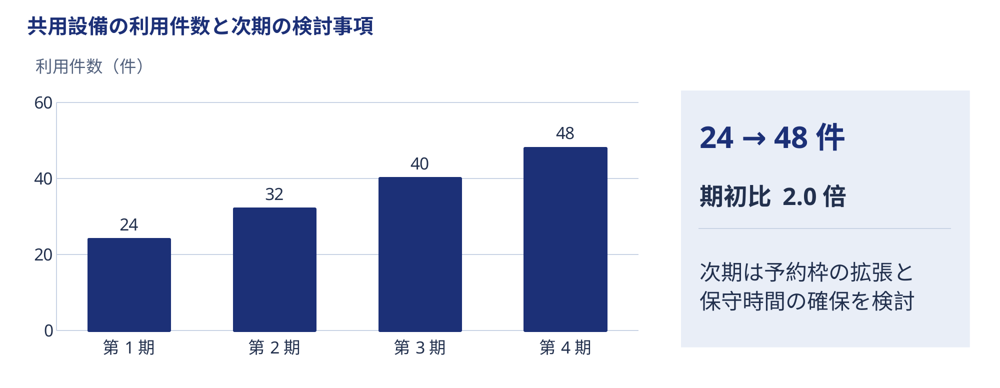
:::

::: cite
m05 / chart_insight — 単一チャートに含意を添える（架空例）
:::

---

<!-- pattern: m06 stacked_bar -->
<!-- source: https://github.com/carnot-tech/jinba-consulting-pptx-skill@e5f35e57e14d3998249a559c620a9286c95b4595 templates/freeform_parts_more_16x9.html part=06 -->

# 積み上げ棒

::: figure
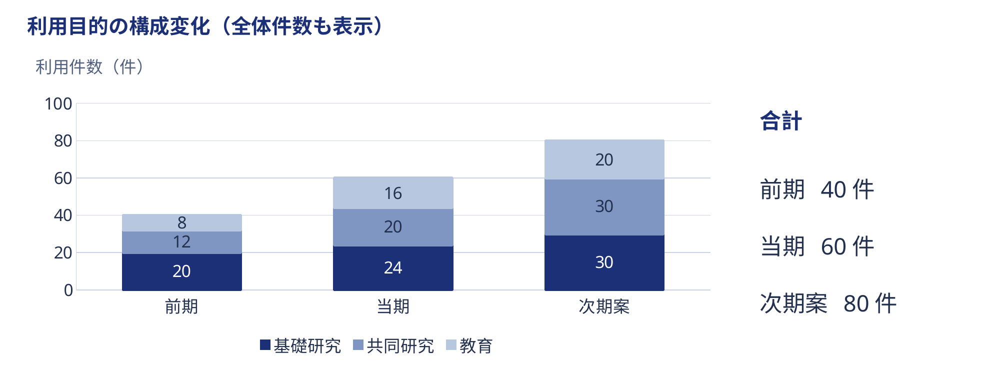
:::

::: cite
m06 / stacked_bar — 内訳の変化を積み上げて示す（架空例）
:::

---

<!-- pattern: m07 waterfall -->
<!-- source: https://github.com/carnot-tech/jinba-consulting-pptx-skill@e5f35e57e14d3998249a559c620a9286c95b4595 templates/freeform_parts_more_16x9.html part=07 -->

# 寄与度ブリッジ

::: figure
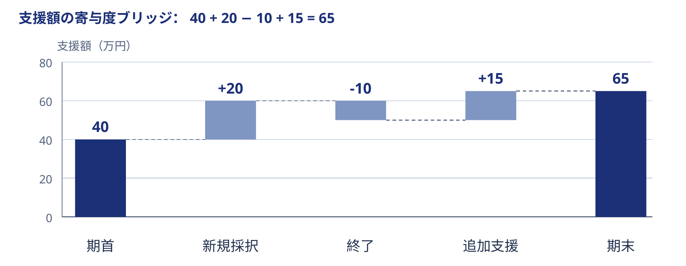
:::

::: cite
m07 / waterfall — 増減の寄与を分解する（架空例）
:::

---

<!-- pattern: m08 true_waterfall -->
<!-- source: https://github.com/carnot-tech/jinba-consulting-pptx-skill@e5f35e57e14d3998249a559c620a9286c95b4595 templates/freeform_parts_more_16x9.html part=08 -->

# 増減ブリッジ

::: figure
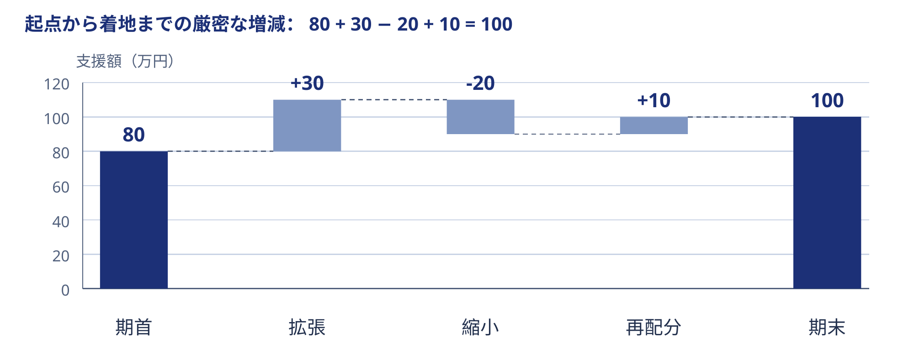
:::

::: cite
m08 / true_waterfall — 起点から着地を浮動棒で厳密につなぐ（架空例）
:::

---

<!-- pattern: m09 small_multiples -->
<!-- source: https://github.com/carnot-tech/jinba-consulting-pptx-skill@e5f35e57e14d3998249a559c620a9286c95b4595 templates/freeform_parts_more_16x9.html part=09 -->

# 小図の並列比較

::: figure
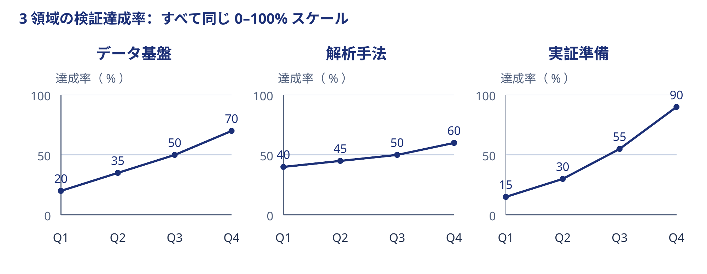
:::

::: cite
m09 / small_multiples — 同じ図法と軸で切り口を比べる（架空例）
:::

---

<!-- pattern: m10 comparison_table -->
<!-- source: https://github.com/carnot-tech/jinba-consulting-pptx-skill@e5f35e57e14d3998249a559c620a9286c95b4595 templates/freeform_parts_more_16x9.html part=10 -->

# 選択肢の比較表

| 評価軸 | 共通シート | 専用台帳 | 既存ツールの改修 |
|:--|:--|:--|:--|
| 導入の手間 | 小 | 中 | 大 |
| 対応付け | 手入力 | 識別子で管理 | 連携設計が必要 |
| 権限管理 | ファイル単位 | 記録単位 | 現行方式に依存 |
| 試行との相性 | 早期に試せる | 運用も確認できる | 本格展開向け |

::: cite
m10 / comparison_table — 選択肢を共通の評価軸で比べる（架空例）
:::

---

<!-- pattern: m11 scenario_table -->
<!-- source: https://github.com/carnot-tech/jinba-consulting-pptx-skill@e5f35e57e14d3998249a559c620a9286c95b4595 templates/freeform_parts_more_16x9.html part=11 -->

# シナリオ比較表

| 項目 | 最小試行 | 標準試行 | 拡張試行 |
|:--|:--|:--|:--|
| 対象の研究班 | 1班 | 3班 | 5班 |
| 支援の前提 | 既存担当が兼務 | 支援時間を確保 | 専任担当を配置 |
| 確かめること | 入力のしやすさ | 班をまたぐ検索 | 運用負荷の分担 |
| 継続判断の条件 | 記録が残る | 記録がつながる | 支援を続けられる |

::: cite
m11 / scenario_table — 前提の違いと結果を並べる（架空例）
:::

---

<!-- pattern: m12 risk_table -->
<!-- source: https://github.com/carnot-tech/jinba-consulting-pptx-skill@e5f35e57e14d3998249a559c620a9286c95b4595 templates/freeform_parts_more_16x9.html part=12 -->

# リスク一覧表

| リスク | 早期の兆候 | 予防・対応 | 担当 |
|:--|:--|:--|:--|
| 入力が止まる | 未記入が続く | 必須項目を見直す | 実験担当 |
| 権限が曖昧 | 共有先を判断できない | 利用範囲を確認する | 管理担当 |
| 支援が集中する | 回答待ちが増える | 当番制で振り分ける | 支援室 |

::: cite
m12 / risk_table — リスク・兆候・対応・担当をそろえる（架空例）
:::

---

<!-- pattern: m13 horizontal_axis_table -->
<!-- source: https://github.com/carnot-tech/jinba-consulting-pptx-skill@e5f35e57e14d3998249a559c620a9286c95b4595 templates/freeform_parts_more_16x9.html part=13 -->

# 横軸評価表

## 要件を横に並べ、方式を同じ物差しで見る

| 方式 ↓ ／ 評価項目 → | 入力の容易さ | 条件の追跡 | 権限の管理 | 改修の容易さ |
|:--|:--:|:--:|:--:|:--:|
| 共通シート | ◎ | △ | △ | ◎ |
| 専用台帳 | ○ | ◎ | ◎ | ○ |
| 既存ツール改修 | △ | ◎ | ○ | △ |

◎ 満たす　○ 条件付きで満たす　△ 追加対応が必要（架空の評価）

::: cite
m13 / horizontal_axis_table — 横軸に並べた要件の充足を評価する（架空例）
:::

---

<!-- pattern: m14 heatmap_table -->
<!-- source: https://github.com/carnot-tech/jinba-consulting-pptx-skill@e5f35e57e14d3998249a559c620a9286c95b4595 templates/freeform_parts_more_16x9.html part=14 -->

# ヒートマップ表

| 記録領域 | 材料班 | 計測班 | 解析班 |
|:--|:--:|:--:|:--:|
| 試料の追跡 | **高**{.status-high} | **中**{.status-mid} | **低**{.status-low} |
| 条件の記録 | **中**{.status-mid} | **高**{.status-high} | **中**{.status-mid} |
| 結果の再利用 | **低**{.status-low} | **中**{.status-mid} | **高**{.status-high} |

高：対応が多い ／ 中：一部に対応 ／ 低：対応が少ない

値は架空の相対評価。色だけでなく文字でも強弱を示す。

::: cite
m14 / heatmap_table — 交点の強弱を濃淡と文字で示す（架空例）
:::

---

<!-- pattern: m15 matrix_2x2 -->
<!-- source: https://github.com/carnot-tech/jinba-consulting-pptx-skill@e5f35e57e14d3998249a559c620a9286c95b4595 templates/freeform_parts_more_16x9.html part=15 -->

# 2×2マトリクス

::: figure
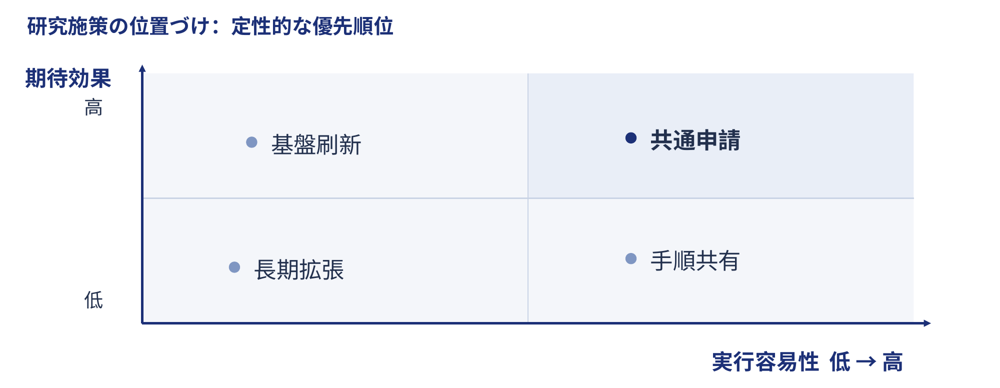
:::

::: cite
m15 / matrix_2x2 — 二軸で位置付けを整理する（架空例）
:::

---

<!-- pattern: m16 process_matrix -->
<!-- source: https://github.com/carnot-tech/jinba-consulting-pptx-skill@e5f35e57e14d3998249a559c620a9286c95b4595 templates/freeform_parts_more_16x9.html part=16 -->

# プロセス×観点の行列

| 観点 ↓ ／ プロセス → | 計画 | 実験 | 共有 |
|:--|:--|:--|:--|
| 記録する情報 | 問い・指標 | 試料・条件 | 元データ・解析条件 |
| 責任を持つ人 | 計画責任者 | 実験担当者 | データ管理担当 |
| 確認すること | 評価可能か | 再現できるか | 利用条件は明確か |

::: cite
m16 / process_matrix — 工程と観点の交点を整理する（架空例）
:::

---

<!-- pattern: m17 nested_row_matrix -->
<!-- source: https://github.com/carnot-tech/jinba-consulting-pptx-skill@e5f35e57e14d3998249a559c620a9286c95b4595 templates/freeform_parts_more_16x9.html part=17 -->

# 入れ子行の行列

<table>
<thead><tr><th>領域</th><th>下位項目</th><th>残す情報</th><th>確認者</th></tr></thead>
<tbody>
<tr><th scope="rowgroup" rowspan="2">実験記録</th><th scope="row">試料</th><td>由来・保管場所</td><td>実験担当</td></tr>
<tr><th scope="row">条件</th><td>装置・設定・版</td><td>実験担当</td></tr>
<tr><th scope="rowgroup" rowspan="2">共有記録</th><th scope="row">権限</th><td>利用範囲・承認者</td><td>管理担当</td></tr>
<tr><th scope="row">公開</th><td>公開先・公開条件</td><td>計画責任者</td></tr>
</tbody>
</table>

::: cite
m17 / nested_row_matrix — 大項目と下位項目を行の入れ子で示す（架空例）
:::

---

<!-- pattern: m18 timeline_matrix -->
<!-- source: https://github.com/carnot-tech/jinba-consulting-pptx-skill@e5f35e57e14d3998249a559c620a9286c95b4595 templates/freeform_parts_more_16x9.html part=18 -->

# 時系列マトリクス

| 項目 ↓ ／ 時期 → | 第1月 | 第2月 | 第3月 |
|:--|:--|:--|:--|
| 記録様式 | 必須項目を決める | 入力例を直す | 様式を固定する |
| 支援体制 | 相談先を決める | 当番制を試す | 分担を見直す |
| 評価 | 検索課題を作る | 経過を観察する | 継続を判断する |

::: cite
m18 / timeline_matrix — 時期と項目を掛け合わせる（架空例）
:::

---

<!-- pattern: m19 theme_card_grid -->
<!-- source: https://github.com/carnot-tech/jinba-consulting-pptx-skill@e5f35e57e14d3998249a559c620a9286c95b4595 templates/freeform_parts_more_16x9.html part=19 -->

# テーマカード

:::: grid-3
::: card
### 記録の信頼性
問い：条件をたどれるか

調べること：版と更新履歴
:::
::: card
### 支援の持続性
問い：相談が滞らないか

調べること：負荷と分担
:::
::: card
### 共有の実用性
問い：次の実験で使えるか

調べること：利用の手順
:::
::::

::: cite
m19 / theme_card_grid — 異なるテーマの問いを並べる（架空例）
:::

---

<!-- pattern: m20 recommendation_pillars -->
<!-- source: https://github.com/carnot-tech/jinba-consulting-pptx-skill@e5f35e57e14d3998249a559c620a9286c95b4595 templates/freeform_parts_more_16x9.html part=20 -->

# 提言の柱

::: band
提言：入力・相談・評価を一つの運用として設計する
:::

:::: grid-3
::: navy-card
### 入力を軽くする
必須項目を絞り込む
:::
::: navy-card
### 相談を早くする
途中でも窓口につなぐ
:::
::: navy-card
### 評価を続ける
月ごとに検索課題を試す
:::
::::

::: cite
m20 / recommendation_pillars — 上位提言を複数の柱に分ける（架空例）
:::

---

<!-- pattern: m21 numbered_imperatives -->
<!-- source: https://github.com/carnot-tech/jinba-consulting-pptx-skill@e5f35e57e14d3998249a559c620a9286c95b4595 templates/freeform_parts_more_16x9.html part=21 -->

# 番号つき打ち手

1. **対象を絞る** — 班をまたぐ検索課題を一つ選ぶ。
2. **記録を結ぶ** — 試料・条件・結果に共通の識別子を付ける。
3. **負担を測る** — 入力と相談にかかる時間を残す。
4. **継続を決める** — 使いやすさと支援負荷を同時に確認する。

::: cite
m21 / numbered_imperatives — 実行することを番号で明示する（架空例）
:::

---

<!-- pattern: m22 scr -->
<!-- source: https://github.com/carnot-tech/jinba-consulting-pptx-skill@e5f35e57e14d3998249a559c620a9286c95b4595 templates/freeform_parts_more_16x9.html part=22 -->

# これまで・課題・対策（流れの3段）

:::: stack
::: note
### 記録は班ごとに蓄積してきた
各班の方法で実験を支えてきた。
:::
::: warning
### 班をまたぐ検索で対応関係が切れる
試料名と条件表の版を確かめ直している。
:::
::: callout
### 共通の識別子から試行する
既存の記録は生かし、対応付けの層を加える。
:::
::::

::: cite
m22 / scr — これまで・課題・対策を三段で語る（架空例）
:::

---

<!-- pattern: m23 issue_to_solution_map -->
<!-- source: https://github.com/carnot-tech/jinba-consulting-pptx-skill@e5f35e57e14d3998249a559c620a9286c95b4595 templates/freeform_parts_more_16x9.html part=23 -->

# 課題と打ち手の対応

::: figure
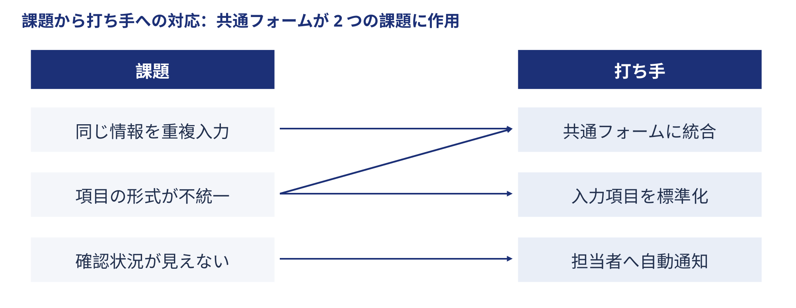
:::

::: cite
m23 / issue_to_solution_map — 課題と解決策の多対多を結ぶ（架空例）
:::

---

<!-- pattern: m24 issue_cause_solution -->
<!-- source: https://github.com/carnot-tech/jinba-consulting-pptx-skill@e5f35e57e14d3998249a559c620a9286c95b4595 templates/freeform_parts_more_16x9.html part=24 -->

# 課題→原因→解決

:::: steps
::: step
### 課題
記録が見つからない
:::
::: step
### 原因
名前と保管先が不統一
:::
::: step
### 解決
識別子と所在を台帳で結ぶ
:::
::::

::: foundation
確認方法：同じ検索課題を試し、迷う箇所が減ったかを観察する。
:::

::: cite
m24 / issue_cause_solution — 課題から原因を経て解決へ進む（架空例）
:::

---

<!-- pattern: m25 issue_tree -->
<!-- source: https://github.com/carnot-tech/jinba-consulting-pptx-skill@e5f35e57e14d3998249a559c620a9286c95b4595 templates/freeform_parts_more_16x9.html part=25 -->

# イシューツリー

::: figure
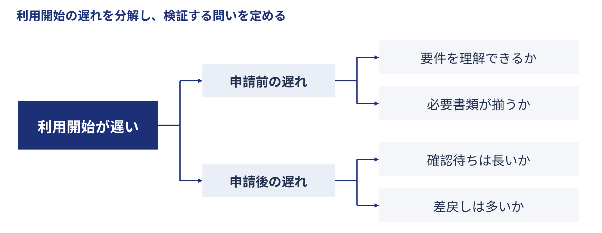
:::

::: cite
m25 / issue_tree — 問いを階層的に分解する（架空例）
:::

---

<!-- pattern: m26 current_target_state -->
<!-- source: https://github.com/carnot-tech/jinba-consulting-pptx-skill@e5f35e57e14d3998249a559c620a9286c95b4595 templates/freeform_parts_more_16x9.html part=26 -->

# 現状と目指す姿

:::: compare
::: card
### 現状：人を経由して探す
担当者に聞く → 保管先を探す

条件表の版を再確認する。
:::
::: card
### 目指す姿：記録からたどる
識別子を引く → 条件と結果を得る

担当者は判断の相談を受ける。
:::
::::

::: foundation
変えないこと：研究上の判断と責任は各研究班が持つ。
:::

::: cite
m26 / current_target_state — 現状と目指す姿の差分を示す（架空例）
:::

---

<!-- pattern: m27 calc_flow -->
<!-- source: https://github.com/carnot-tech/jinba-consulting-pptx-skill@e5f35e57e14d3998249a559c620a9286c95b4595 templates/freeform_parts_more_16x9.html part=27 -->

# 計算ロジックの流れ

::: figure
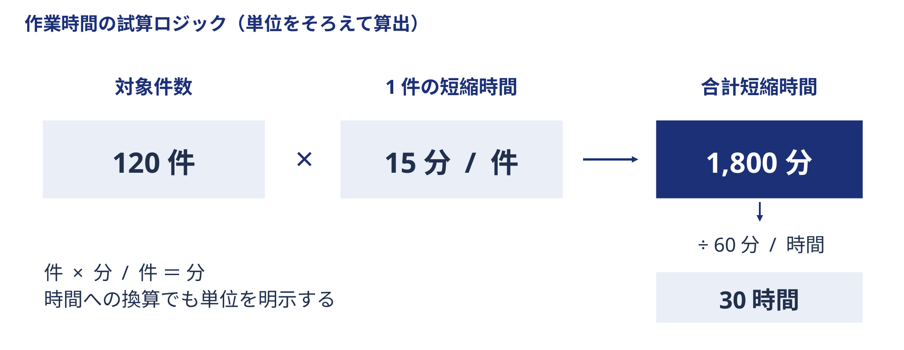
:::

::: cite
m27 / calc_flow — 入力・式・結果の計算関係を示す（架空例）
:::

---

<!-- pattern: m28 process_flow -->
<!-- source: https://github.com/carnot-tech/jinba-consulting-pptx-skill@e5f35e57e14d3998249a559c620a9286c95b4595 templates/freeform_parts_more_16x9.html part=28 -->

# プロセスの段階

:::: steps
::: step
### 01 受け付け
対象と相談内容を確認
:::
::: step
### 02 整理
記録の対応を点検
:::
::: step
### 03 試行
検索課題を実行
:::
::: step
### 04 振り返り
続け方を合意
:::
::::

::: foundation
各段階の成果物：受付票 → 対応台帳 → 観察記録 → 継続判断
:::

::: cite
m28 / process_flow — 段階と各成果物を順に示す（架空例）
:::

---

<!-- pattern: m29 cycle -->
<!-- source: https://github.com/carnot-tech/jinba-consulting-pptx-skill@e5f35e57e14d3998249a559c620a9286c95b4595 templates/freeform_parts_more_16x9.html part=29 -->

# 循環サイクル

::: figure
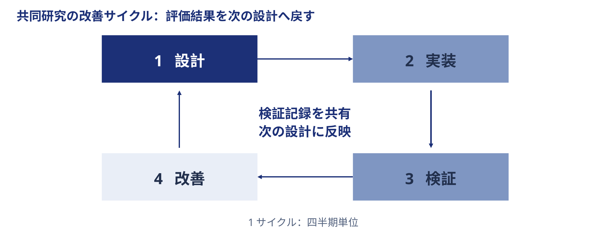
:::

::: cite
m29 / cycle — 実行と学習の循環を示す（架空例）
:::

---

<!-- pattern: m30 chevron_rail -->
<!-- source: https://github.com/carnot-tech/jinba-consulting-pptx-skill@e5f35e57e14d3998249a559c620a9286c95b4595 templates/freeform_parts_more_16x9.html part=30 -->

# 矢羽の段階（全体像の見出し）

<h3>構想</h3>
問いを共有

<h3>試行</h3>
条件をそろえる

<h3>展開</h3>
運用を広げる

::: callout
今回の焦点は「試行」。構想と展開の間で、実行条件を具体化する。
:::

::: cite
m30 / chevron_rail — 全体の進行段階を見出しにする（架空例）
:::

---

<!-- pattern: m31 chevron_value_chain -->
<!-- source: https://github.com/carnot-tech/jinba-consulting-pptx-skill@e5f35e57e14d3998249a559c620a9286c95b4595 templates/freeform_parts_more_16x9.html part=31 -->

# バリューチェーン

<h3>採取</h3>
由来を残す

<h3>計測</h3>
条件を残す

<h3>解析</h3>
根拠を残す

<h3>再利用</h3>
次の問いへ

::: foundation
横断支援：識別子・権限確認・品質点検で、各段階の情報をつなぐ。
:::

::: cite
m31 / chevron_value_chain — 活動の連鎖と横断支援を示す（架空例）
:::

---

<!-- pattern: m32 decision_fork -->
<!-- source: https://github.com/carnot-tech/jinba-consulting-pptx-skill@e5f35e57e14d3998249a559c620a9286c95b4595 templates/freeform_parts_more_16x9.html part=32 -->

# 分岐と判断

::: figure
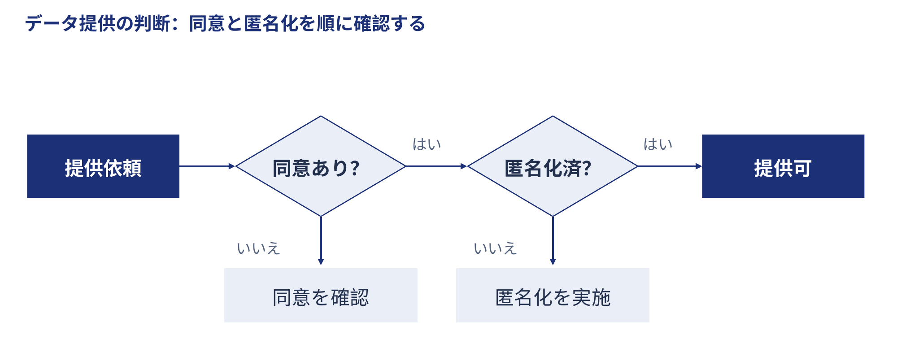
:::

::: cite
m32 / decision_fork — 判断条件から進路を分ける（架空例）
:::

---

<!-- pattern: m33 roadmap -->
<!-- source: https://github.com/carnot-tech/jinba-consulting-pptx-skill@e5f35e57e14d3998249a559c620a9286c95b4595 templates/freeform_parts_more_16x9.html part=33 -->

# ロードマップ

::: figure
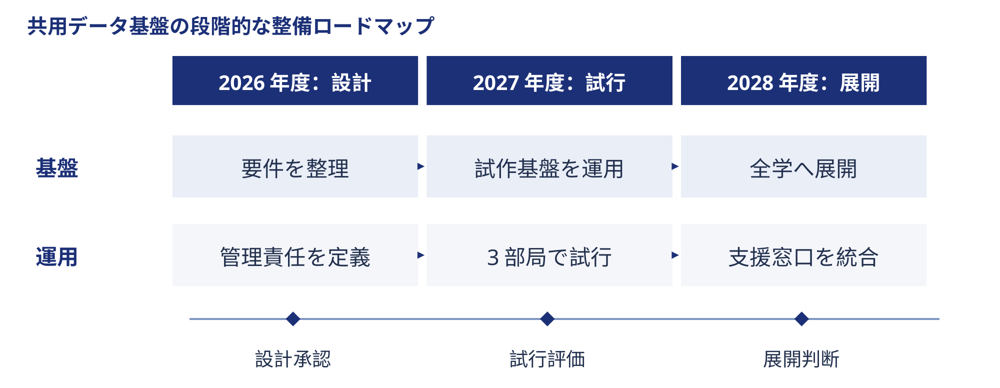
:::

::: cite
m33 / roadmap — 時期別の実行方針を示す（架空例）
:::

---

<!-- pattern: m34 gantt -->
<!-- source: https://github.com/carnot-tech/jinba-consulting-pptx-skill@e5f35e57e14d3998249a559c620a9286c95b4595 templates/freeform_parts_more_16x9.html part=34 -->

# ガントチャート

::: figure
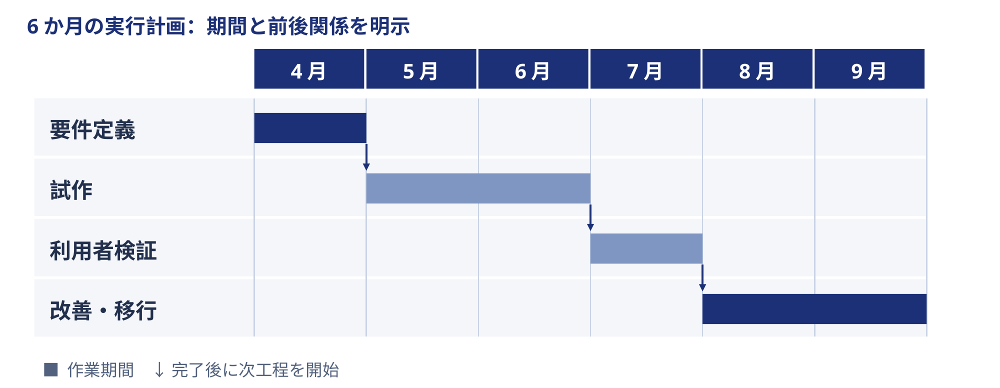
:::

::: cite
m34 / gantt — 期間・並行・節目を工程で示す（架空例）
:::

---

<!-- pattern: m35 decision_page -->
<!-- source: https://github.com/carnot-tech/jinba-consulting-pptx-skill@e5f35e57e14d3998249a559c620a9286c95b4595 templates/freeform_parts_more_16x9.html part=35 -->

# 意思決定ページ

::: band
決めること：3研究班で記録共通化の試行を始めるか
:::

| 判断に必要な項目 | 今回の依頼案 |
|:--|:--|
| 範囲 | 試料・条件・結果の対応付けに限定 |
| 前提 | 各班の担当者と支援時間を確保 |
| 依頼 | 試行への参加と担当者の選定を承認 |
| 次の判断 | 第3月の評価後、継続・修正・終了を決める |

::: cite
m35 / decision_page — 決めること・前提・依頼をそろえる（架空例）
:::
